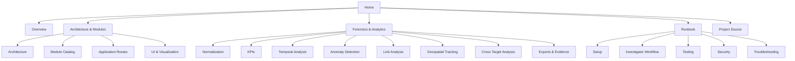

# 🛡️ T.R.I.A.D. - Telecom Records and Intelligence Analysis Dashboard

> A structured Obsidian knowledge base for the T.R.I.A.D.ligence & Link Analysis Platform v2.0.

## 🧭 Start here

| Area | What you'll find |
|---|---|
| [[01 - Project Overview]] | Purpose, goals, users and capabilities |
| [[02 - Scope & Objectives]] | In-scope and out-of-scope functionality |
| [[03 - System at a Glance]] | End-to-end system picture |
| [[04 - Glossary]] | Telecom, forensic and project terminology |
| [[01 - Architecture & Modules/01 - Architecture]] | Technical architecture |
| [[01 - Architecture & Modules/02 - Module Catalog]] | Detailed module inventory |
| [[02 - Forensics & Analytics/01 - CDR Normalization]] | Input mapping and normalization |
| [[02 - Forensics & Analytics/05 - Anomaly Detection]] | Burst, dormancy, travel and device alerts |
| [[02 - Forensics & Analytics/07 - Link Analysis]] | Graph intelligence |
| [[02 - Forensics & Analytics/08 - Geospatial Tracking]] | Tower trajectory analysis |
| [[02 - Forensics & Analytics/09 - Cross Target Analysis]] | Multi-target correlation |
| [[03 - Runbook/01 - Installation & Setup]] | Install and launch |
| [[03 - Runbook/02 - Investigator Workflow]] | Practical investigation sequence |
| [[03 - Runbook/05 - Troubleshooting]] | Common failures |
| [[04 - Project Source/Source Index]] | Original runnable source tree |

## 🗺️ Knowledge map



## 📦 What is included

- Original Flask/Python application preserved under [[04 - Project Source/Source Index]]
- Structured forensic methodology notes
- Mermaid architecture and workflow diagrams
- Module and route catalog
- Data model and normalization documentation
- Detection methodology and limitations
- Operational runbook
- Security hardening guidance
- Testing and troubleshooting checklists

> **Important:** The analytics produce investigative leads. They should not be treated as proof of wrongdoing without independent validation.

## 👤 How to use this vault

If you are new to the project, do not start with the Python files. Follow the documentation in this order:

1. **[[01 - Project Overview]]** — understand what the system is.
2. **[[02 - Scope & Objectives]]** — understand what it is intended to do.
3. **[[03 - System at a Glance]]** — understand the full pipeline.
4. **[[01 - Architecture & Modules/01 - Architecture]]** — understand how components connect.
5. **[[01 - Architecture & Modules/02 - Module Catalog]]** — learn what each class does.
6. **[[02 - Forensics & Analytics/01 - CDR Normalization]]** — learn how raw data becomes usable.
7. **[[02 - Forensics & Analytics/03 - KPI & Behavioral Profiling]]** — learn the basic measurements.
8. **[[02 - Forensics & Analytics/05 - Anomaly Detection]]** — learn how suspicious patterns are flagged.
9. **[[02 - Forensics & Analytics/07 - Link Analysis]]** — understand communication relationships.
10. **[[02 - Forensics & Analytics/08 - Geospatial Tracking]]** — understand tower-based movement.
11. **[[02 - Forensics & Analytics/09 - Cross Target Analysis]]** — compare multiple targets.
12. **[[03 - Runbook/02 - Investigator Workflow]]** — see how an analyst would actually use it.

## 🧩 Three mental models

### Model 1 — Data pipeline

Think of the project as a funnel:

```text
Many messy records
      ↓
One consistent schema
      ↓
Measurements
      ↓
Patterns
      ↓
Relationships
      ↓
Investigative leads
```

### Model 2 — Three dimensions

Most investigations can be understood through three dimensions:

- **Time** — when did activity happen?
- **Relationships** — who communicated with whom?
- **Location** — which cells/towers were involved?

The strongest investigations combine all three instead of relying on a single signal.

### Model 3 — Lead → validation

```text
Algorithm finds something unusual
          ↓
Analyst inspects source records
          ↓
Analyst checks data quality
          ↓
Analyst adds context
          ↓
Finding is accepted, qualified, or rejected
```

This distinction is central to using the platform responsibly.
