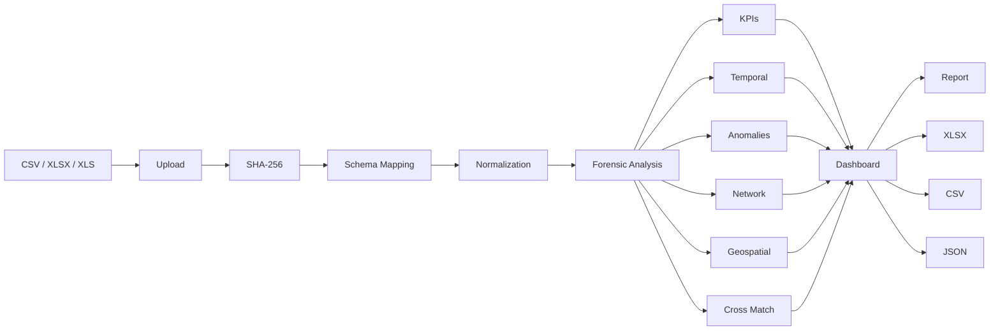

# System at a Glance

## End-to-end pipeline



## Architectural principle

The application separates:

- **data ingestion** from
- **analysis** from
- **presentation**.

This is primarily implemented through the `CDRNormalizer`, `ForensicAnalyzer`, `DeviceSwapDetector`, `ImpossibleTravelDetector`, `NetworkGraphBuilder`, `GeoTracker` and `CrossMatchEngine` classes.

## Main source files

| Source | Responsibility |
|---|---|
| `app.py` | Flask routes, sessions, exports, history |
| `cdr_engine.py` | Core forensic analytics |
| `generate_sample_cdr.py` | Synthetic Target A data |
| `generate_sample_cdr_2.py` | Synthetic Target B data |
| `index_history.py` | History indexing utility |

See [[01 - Architecture & Modules/02 - Module Catalog]] for details.

## 🔍 Reading the architecture

There are four major stages.

### Stage 1 — Ingestion

The application receives a file and saves it using a generated session identifier plus a sanitized filename.

### Stage 2 — Intelligence

`cdr_engine.py` transforms the data and runs the analytics.

### Stage 3 — Presentation

Flask routes provide HTML pages and JSON APIs. The browser turns the JSON into charts, graphs and maps.

### Stage 4 — Persistence

The current prototype stores completed investigation results in JSON cache files and maintains a history list.

## Why modularity helps

Without separation, one giant Flask route would have to:

- read the spreadsheet,
- normalize columns,
- calculate KPIs,
- detect anomalies,
- build graphs,
- prepare maps,
- save history,
- generate exports.

That would be difficult to test and maintain.

The current design moves domain logic into reusable classes.

## One-record journey

A single CDR event can flow like this:

```text
"Calling Number"
        ↓
COLUMN_MAP
        ↓
caller
        ↓
ForensicAnalyzer
        ↓
contact / temporal / KPI analysis
        ↓
NetworkGraphBuilder
        ↓
graph node/edge
```

This is the key idea behind the architecture.
