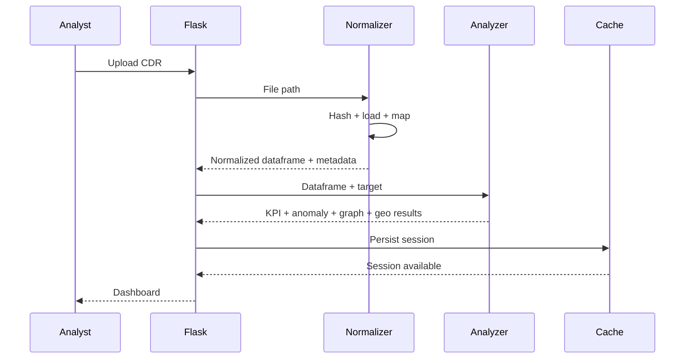

# Data Flow & State

## Single-target flow



## Session model

The application creates session identifiers and stores investigation results in `cache/`.

History is maintained separately through the history JSON mechanism.

## Why cache exists

Caching allows:

- dashboard reopening
- report generation
- export generation
- investigation history
- API endpoints to reference a completed analysis

## Operational implication

Cache files can contain sensitive analytical results. Production deployments should protect and manage them as sensitive case data.

## 💾 Understanding state

A session ID acts as the link between:

```text
uploaded evidence
      ↓
analysis result
      ↓
cached JSON
      ↓
dashboard/API/report/export
```

The application generates UUIDs so different investigations can be separated.

## Why cache is needed

Without cache, every time an analyst opened a dashboard the application might need to repeat the full analysis.

With cache:

```text
Analyze once
   ↓
Store results
   ↓
Reuse results
```

## Current prototype storage

The application creates:

```text
uploads/
cache/
cache/history.json
cache/<session-id>.json
```

This is simple and useful for a prototype.

## Production evolution

A mature system could replace this with:

```text
Case
 ├── Evidence
 ├── Analysis Run
 ├── Findings
 ├── Reports
 └── Audit Events
```

That would make the data model much more suitable for multi-user forensic work.
