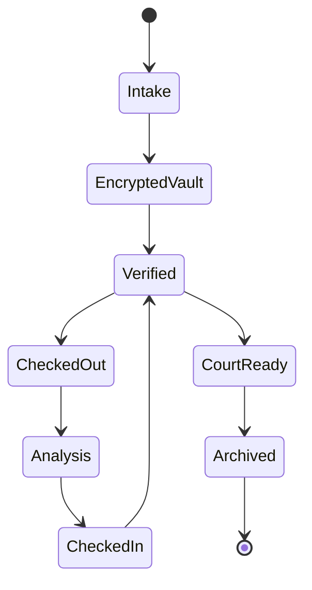

# Evidence Lifecycle

## Lifecycle diagram

## Intake

A user with `upload_evidence` permission submits an evidence file.

The application creates an Evidence database row and obtains its ID.

## Protection

The file is hashed and encrypted before being written to its vault path.

## Custody

The current custodian is tracked on the evidence record and lifecycle events are added to the CoC ledger.

## Analysis

Authorized analysts can run CDR analytics for telecom evidence.

## Disposition

The data model contains a disposition action and archived/closed case states. A complete production disposition workflow should define retention, legal holds, deletion authorization and verification.
