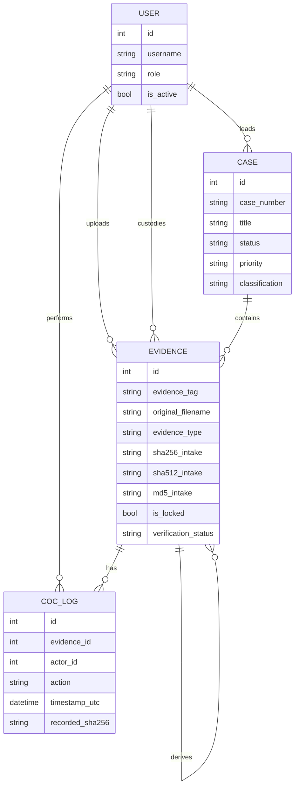

# DEMS Data Model

## Entity relationship



## Case numbering

The model generates case numbers in a `CAS-YYYY-XXXXXX`-style pattern using a random alphanumeric suffix.

## Evidence tags

Evidence tags are generated from the case ID and an incrementing evidence count, such as:

```text
EVD-0001-0001
```

## Derived evidence

`source_evidence_id` allows outputs to reference the evidence from which they originated.
