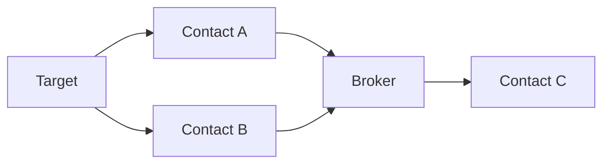

# Link Analysis

## Purpose

Transform communication records into a graph that can expose relationships that are difficult to see in rows.

## Graph model



## Nodes

The network builder creates nodes for phone numbers/identifiers.

Node metadata includes concepts such as:

- target status
- degree
- centrality
- label

## Edges

Edges represent caller → receiver relationships.

Edge attributes include:

- call count
- duration
- width
- directional arrow

## Degree

Degree can indicate how many relationships a node has in the constructed graph.

A high-degree number is not automatically a broker or suspect. It may be:

- a service number
- a company switchboard
- a family hub
- a call center
- an automated service

## Centrality

The project includes centrality information to help size or prioritize graph nodes.

Use centrality as a ranking aid, not as a conclusion.

## Investigation questions

- Who communicates with the target most often?
- Which contacts connect otherwise separate groups?
- Are there shared intermediaries?
- Does a contact become important only in a particular time period?
- Does the graph change after a device change?

## 🕸️ Link analysis for beginners

A spreadsheet is a list.

A graph is a relationship map.

If the records contain:

```text
A → B
A → C
B → D
C → D
```

the graph makes the shared structure obvious:

```text
     B
    / \
   A   D
    \ /
     C
```

## Directed relationships

The project uses a directed graph.

That means:

```text
Caller → Receiver
```

is different from:

```text
Receiver → Caller
```

The edge stores call count and duration.

## Degree

Degree is the number of graph connections associated with a node.

A high-degree node deserves attention because it is structurally connected, not because it is automatically suspicious.

## Centrality

Degree centrality provides a normalized structural measure.

It can help prioritize nodes when the network is large.

## Node limit

The graph builder limits the network to the top nodes by aggregated degree/count, with the target always included.

This keeps browser visualization manageable.

## Investigation sequence

```text
Start with target
      ↓
Find top contacts
      ↓
Inspect high-degree nodes
      ↓
Look for shared intermediaries
      ↓
Filter by time period
      ↓
Return to raw records
```
