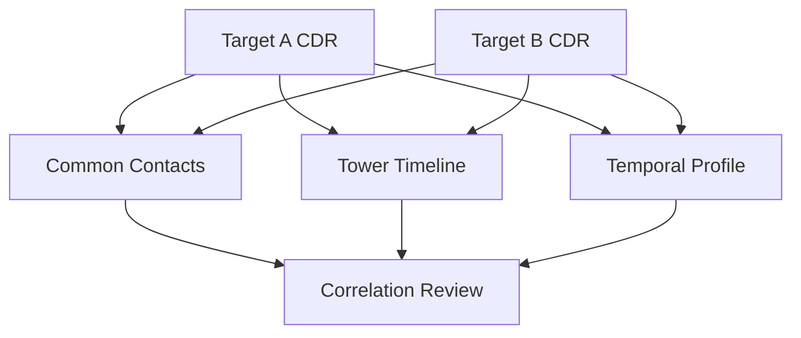

# Cross Target Analysis

## CrossMatchEngine

The engine accepts multiple datasets in the form:

```python
{
    "label": "...",
    "df": dataframe,
    "target": "..."
}
```

## Common contacts

A contact is considered shared when it appears in at least two datasets.

Output includes:

- contact
- datasets containing it
- target count

## Co-location

The engine groups events by `cell_id` and compares timestamps across datasets.

Default:

```text
±15 minutes
```

A result includes:

- cell ID
- target A
- target B
- timestamp A
- timestamp B
- time difference
- latitude
- longitude

## Contact matrix

The matrix represents how many contacts are shared between each dataset pair.

## Investigation pattern



## False-correlation risk

Shared contacts can arise naturally.

Co-location can also be caused by:

- crowded urban cells
- shared workplaces
- transport corridors
- family/business relationships
- tower coverage characteristics

Correlations should be ranked and validated rather than treated as conclusions.

## 👥 Why compare targets?

Sometimes one target's dataset is ambiguous.

A second dataset can add context.

For example:

```text
Target A ── shared contact ── Target B
Target A ── Tower X
Target B ── Tower X
Target A ── 10:00
Target B ── 10:07
```

The combination may justify deeper review.

## Common contacts

The engine identifies contacts appearing in multiple datasets.

This is useful for narrowing a large relationship universe.

## Co-location logic

The implementation groups records by `cell_id` and compares timestamps.

The documented default comparison window is ±15 minutes.

This means two events can be considered temporally close even if their timestamps are not identical.

## Why co-location is not proof

A cell can cover many people at once.

Two targets could legitimately share:

- a workplace
- a home area
- a railway station
- a shopping area
- a city center

## Stronger correlation

A stronger lead generally combines several independent dimensions:

```text
shared contact
+
same/nearby cell
+
close timestamp
+
repeated occurrence
+
supporting context
```

Even then, the result remains a correlation that should be validated.
