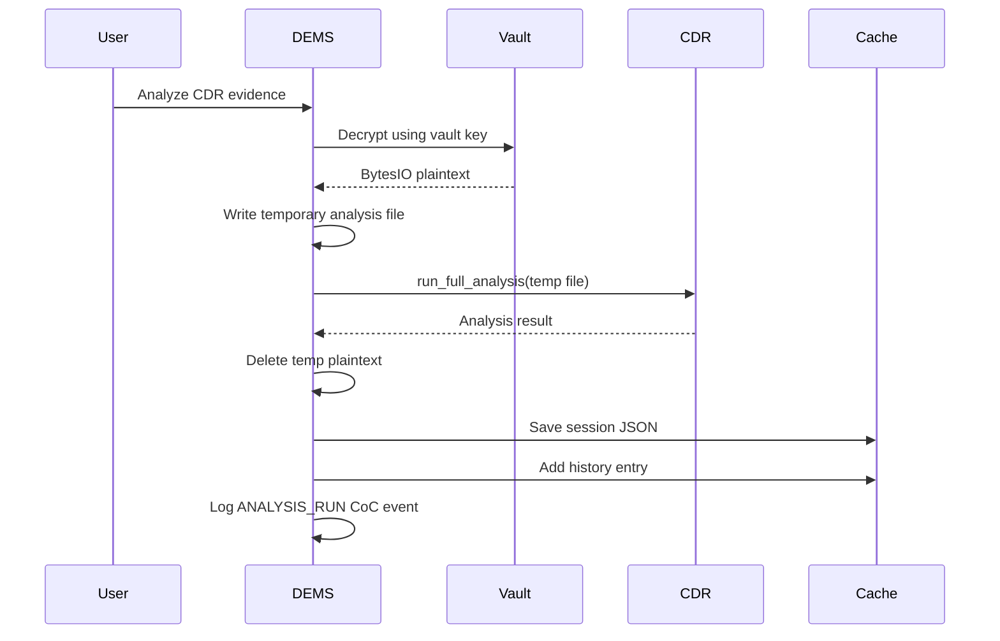

# CDR Analysis From DEMS Evidence

## Why this integration matters

The DEMS layer can run the existing CDR engine against evidence stored in the encrypted vault.

This avoids asking the analyst to manually extract the original evidence before analysis.

## Flow

## Important detail

The crypto helper performs decryption in memory. The integration then creates a temporary plaintext file because `run_full_analysis()` accepts a file path.

The temporary file is removed in the `finally` block.

## Provenance

The generated analysis metadata includes:

- original filename
- case reference
- DEMS evidence ID
- CDR session ID
- source SHA-256 through the history entry

This creates a bridge between the DEMS evidence record and the older CDR analysis history.
