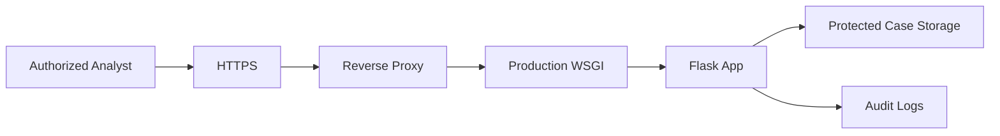

# Security & Deployment

## Sensitive data

CDRs can expose:

- communications
- identities
- movement patterns
- relationships

Treat them as sensitive.

## Secret key

The supplied application has a development fallback secret.

Production should use an environment variable:

```text
SECRET_KEY=<strong-random-secret>
```

Do not commit real production secrets.

## Storage

Protect:

```text
uploads/
cache/
```

Recommended controls:

- encryption at rest
- least privilege
- case-based access control
- audit logging
- retention/deletion policy
- secure backups

## Web controls

Recommended production hardening:

- HTTPS
- authentication
- authorization
- CSRF protection
- upload size limits
- MIME/content validation
- secure cookies
- rate limiting
- security headers
- dependency patching

## Deployment architecture



## Privacy

Do not publish real CDR datasets, screenshots containing subscriber data, or exported reports to public repositories.

## 🔒 Security model to aim for

The current project is a local prototype. A production forensic application should add several security layers.

### Identity

Who is the analyst?

→ authentication

### Authorization

What may the analyst access?

→ case/role permissions

### Accountability

What did the analyst do?

→ audit logs

### Confidentiality

Who can read the evidence?

→ encryption + access control

### Integrity

Was the evidence modified?

→ hashes + controlled storage

## Sensitive directories

The application writes to:

```text
uploads/
cache/
```

Both can contain sensitive information.

## Development secret

The supplied code includes a fallback Flask secret. That is convenient for local testing but inappropriate as a production secret.

Use an environment variable for deployment.

## Production architecture

```text
Analyst
  ↓ HTTPS
Reverse Proxy
  ↓
WSGI Server
  ↓
Flask
  ↓
Case Database / Object Storage
  ↓
Encrypted Backups
```

## Deployment rule

Never place real telecom records in a public Git repository.
