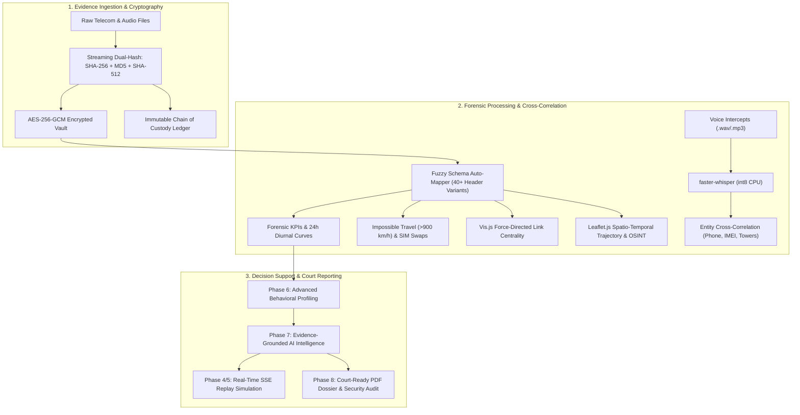

# 🛡️ T.R.I.A.D. — Telecom Records & Intelligence Analysis Dashboard (v2.0 Enterprise)

> **Enterprise-Grade Telecom Forensics, Multi-Target Link Analysis & Digital Evidence Management System (DEMS)**  
> Compliant with **ISO/IEC 27037** (Digital Evidence Handling) and **NIST SP 800-86**.  
> Inspired by Palantir Gotham & IBM i2 Analyst's Notebook.

---

## 🌟 Overview

**T.R.I.A.D.** (**T**elecom **R**ecords & **I**ntelligence **A**nalysis **D**ashboard) is an enterprise investigation and forensics platform designed for law enforcement, intelligence analysts, and cyber defense investigators. 

It unifies the full digital investigation lifecycle: from cryptographic evidence seizure and custody tracking, to multi-target CDR normalization, spatio-temporal cell tower mobility tracking, speech-to-text audio intelligence, cross-evidence correlation, and court-admissible forensic reporting.

---

## ⚡ Core Forensic Modules & Capabilities



---

### 1. 🔐 Digital Evidence Management System (DEMS)
* **Cryptographic Vault Storage:** Seized evidence is encrypted with **AES-256-GCM** authenticated encryption (`[12B Nonce][16B Tag][Ciphertext]`) derived via **PBKDF2-HMAC-SHA256** (600,000 iterations per NIST SP 800-63B) and HKDF.
* **Dual/Triple Streaming Hashes:** Calculates SHA-256, MD5, and SHA-512 in streaming chunks *prior* to disk persistence.
* **In-Memory Streaming Decryption:** Plaintext never touches disk during analysis, download, or streaming, preventing forensic spillage.
* **1-Click Integrity Sentinel:** Recalculates hashes and ciphertext tags on demand (`/dems/verify/<id>`), automatically flagging any bit-level tampering.
* **Role-Based Access Control (RBAC):** Hierarchical privilege matrix supporting `Admin`, `Lead Investigator`, `Forensic Analyst`, and `Auditor`.
* **Immutable Chain of Custody (CoC):** Append-only event ledger tracking all evidence actions (`INGESTION`, `CHECK_OUT`, `ANALYSIS_RUN`, `INTEGRITY_CHECK`, `DISPOSITION`).

---

### 2. 📥 Intelligent Normalization & Anomaly Detection
* **Universal Telecom Schema Mapper:** Auto-maps heterogeneous CDR formats across 40+ column naming conventions (Caller, Receiver, Timestamp, Duration, Cell ID, Latitude/Longitude, IMEI, IMSI).
* **Impossible Travel Velocity:** Identifies supersonic tower hops (>900 km/h) calculated via the great-circle Haversine formula.
* **Device Swapping & IMSI Tracking:** Detects **Handset Hopping** (single subscriber utilizing multiple IMEIs) and **SIM Swapping** (multiple subscribers on a single handset).
* **Communication Bursts & Dormancy:** Detects sudden high-frequency bursts (>5 calls in 10 minutes) and irregular dormant windows (>14 days inactivity).

---

### 3. 🕸️ Graph Intelligence & Spatio-Temporal Tracking
* **Interactive Link Analysis (Vis.js):** Force-directed communication networks with betweenness and degree centrality sizing, ego-network clustering, physics toggles, and node inspectors.
* **Tactical GIS Tracking (Leaflet.js):** Tower-by-tower breadcrumb trails, chronological sequence numbers, heatmaps, and trajectory timeline playback.
* **Public OSINT Overlays:**
  * 🌐 TeleGeography Global Submarine Fiber-Optic Cables
  * 🌋 USGS M4.5+ Real-Time Global Seismic Activity
  * 🌧️ RainViewer Dynamic Precipitation Radar
  * ✈️ OpenSky Network Commercial Aircraft ADS-B Telemetry

---

### 4. 🎙️ Audio Intelligence & Cross-Evidence Correlation
* **Local Speech-to-Text (`faster-whisper`):** Offline, CPU-optimized int8 Whisper transcription for seized `.wav` and `.mp3` recordings (no GPU/CUDA required).
* **Regex Forensic Entity Extraction:** Automatically extracts Phone numbers, IMEIs, IMSIs, Cell IDs, timestamps, and GPS coordinates from transcripts and case notes.
* **Cross-Evidence Correlation:** Correlates intercepted spoken statements with telecom CDR logs using weighted confidence matching.

---

### 5. 🤖 Evidence-Grounded AI Intelligence & Suspect Profiler (Phase 7 Enterprise)
* **Multi-Tier Inference Architecture:**
  * **Tier 1 — Local Ollama LLM:** Offline, privacy-preserving local LLM execution (`llama3.2`, `mistral`, `deepseek-r1`) via `http://localhost:11434`.
  * **Tier 2 — Local OpenAI Endpoint:** Compatible with LM Studio, vLLM, and LocalAI (`http://localhost:1234/v1`).
  * **Tier 3 — Cloud LLM Integration:** Google Gemini, OpenAI, OpenRouter, Groq, and DeepSeek.
  * **Tier 4 — Autonomous High-Fidelity Forensic Neural Agent:** 100% offline, zero-crash deterministic reasoning kernel running directly on CPU without external dependencies.
* **Dynamic Multi-Factor Threat Risk Scoring (0–100):** Mathematically evaluates Velocity Risk, Hardware Evasion, Nocturnal Telemetry, and Network Centrality.
* **Suspect Behavioral Profiling & OpSec Detection:** Automated classification of behavioral archetypes (e.g., Evasive Multi-Device Coordinator, Central Dispatcher, Mobile Courier) and identification of counter-surveillance tactics (Handset Hopping, SIM Swapping, Impossible Travel).
* **Evidence-Grounded Hypotheses Matrix:** Formulates testable investigative hypotheses citing verified CDR timestamps, tower azimuths, delta velocities, and competing/alternative explanations.
* **Interactive Analyst Studio & Quick Examiner Presets:** Real-time conversational interface with one-click examiner demo chips and downloadable dossiers in Markdown, JSON, and printable court formats.

---

### 6. 📑 Court-Ready Reporting & Security Validation (Phase 8)
* **Court-Admissible PDF Dossier:** Generates official ReportLab PDF dossiers with evidence chain-of-custody stamps, cryptographic checksums, analytical charts, and investigator sign-off blocks.
* **Multi-Format Exports:** Multi-tab Excel workbooks (`.xlsx`), normalized CSVs, and raw JSON evidence bundles.
* **Live Security Validation Dashboard:** Visual verification of cryptographic parameters (PBKDF2 iteration counts, GCM nonce sizes) and real-time evidence integrity sampling.

---

### 7. ⏱️ Real-Time Intelligence & Event Replay (Phases 4 & 5)
* **Server-Sent Events (SSE) Stream:** Replays recorded CDR events as a simulated live operations feed (`CALL`, `SMS`, `LOCATION`).
* **Interactive Playback Controls:** 1x, 2x, and 5x replay speed controls with synchronized map marker updates.

---

## 🛠️ Technology Stack

| Layer | Technologies |
|---|---|
| **Backend Framework** | Python 3.10+, Flask 3.0, SQLAlchemy 2.0 / Flask-SQLAlchemy 3.1 |
| **Data Analytics** | Pandas 2.2, NumPy 1.26, NetworkX 3.3, Geopy 2.4, OpenPyXL 3.1 |
| **Cryptography & DEMS** | Cryptography 42.0 (AES-256-GCM, PBKDF2, HKDF), Flask-Bcrypt, SQLite 3 (WAL mode) |
| **Audio Transcription** | `faster-whisper` 1.2 (int8 CPU execution) |
| **Document Generation** | ReportLab 3.x / 4.x (PDF generation) |
| **Frontend Styling** | Tailwind CSS (Cyber-Dark Theme: `#000000`, `#0a0a0a`), Lucide Icons |
| **Visualizations** | Vis.js Network 9.1, Leaflet.js 1.9, Chart.js 4.4, DataTables |

---

## 🚀 Quick Start & Installation

### 1. Prerequisites
* Python 3.10 or higher.

### 2. Setup Virtual Environment
```bash
# Windows
python -m venv .venv
.\.venv\Scripts\activate

# Linux / macOS
python3 -m venv .venv
source .venv/bin/activate
```

### 3. Install Dependencies
```bash
pip install -r requirements.txt
```

### 4. Configuration (Optional)
Copy `.env.example` to `.env`:
```bash
cp .env.example .env
```

### 5. Launch Application
```bash
python app.py
```
Open **`http://localhost:5001`** in your browser.

---

## 🔑 Default Credentials (DEMS Vault)

| Role | Username | Password | Privileges |
|---|---|---|---|
| **Administrator** | `admin` | `admin123` | Full access, user management, vault configuration |
| **Lead Investigator** | `investigator` | `investigator123` | Create cases, upload evidence, transfer custody |
| **Forensic Analyst** | `analyst` | `analyst123` | Run CDR analysis, transcribe audio, verify integrity |
| **Auditor** | `auditor` | `auditor123` | Read-only view of cases, evidence, and CoC ledger |

---

## 🧪 Running Tests

Execute the comprehensive test suites:
```bash
# Enterprise DEMS, Cryptography & Geoint verification
python test_enterprise_dems_geoint.py

# Forensic In-Memory Vault & Analytics verification
python test_dems_forensics.py

# Phase 7 AI Intelligence, Local LLM & Threat Risk verification
python test_ai_intelligence_upgrades.py
```

---

## 🔒 Security & Compliance Notice

T.R.I.A.D. is engineered in accordance with **ISO/IEC 27037** standards for digital evidence handling. Ensure real-world operational deployments enforce secure key management (HSM / KMS) and comply with local data protection regulations.
